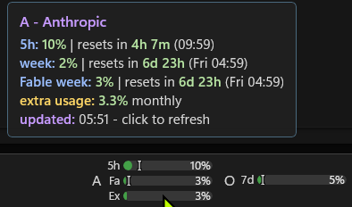
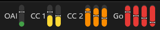
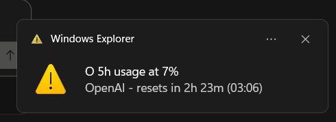

# Taskbar AI Quota Bars

Shows Anthropic Claude, OpenAI/Codex, Google Antigravity, GitHub Copilot, and OpenCode Go AI agent and LLM subscription quota usage as compact bars on the Windows 11 taskbar.
Can show on the primary taskbar only, all taskbars, or one specific monitor.

## What It Shows

Each visible account gets one compact taskbar column. Choose among the provider's supported bars: 5-hour, weekly, Anthropic Fable weekly, Anthropic monthly extra usage, and OpenAI prepaid credits measured against a max you set (the API reports only the balance). Antigravity maps available short-window and weekly Gemini pools and the Gemini Argon weekly pool (keyed `Ar`, on by default) to its bars; Claude/GPT pool limits appear in the details flyout. Argon pools with other windows, and Argon on Antigravity servers without pooled-quota support, aren't shown; before 2.6.0 Argon counted toward the Gemini bars, so earlier Gemini history can include it. GitHub Copilot shows one bar, its monthly AI credits allowance (keyed `Mo`; Copilot Free's included), resetting on the 1st of each month; the details flyout shows the credits used of the allowance (to two decimals), an additional-usage line when GitHub reports usage past the allowance (only what GitHub reports as additional usage, not a bill), and for an organization's pooled seat without a per-user limit the pooled credits used (or that the pool is used up) instead of a bar. The flyout and notifications name the allowance's unit: AI credits; premium requests on plans GitHub doesn't bill by tokens; chat requests for a Copilot Free account that GitHub still reports in the older form. OpenCode Go shows its 5-hour, weekly and monthly usage limits (the monthly keyed `Mo`, all three on by default); the 5-hour window starts at its first use, the weekly is a calendar week and the monthly resets on your subscription's day of the month, and the details flyout marks a window whose limit is reached (with Extra Usage turned on in OpenCode, Go then keeps working from your balance). The monthly window's start is estimated from its reset: for subscriptions on the 29th to 31st it can be up to three days early when the reset falls in a shorter month, which moves its chart, pace and projection (and the window length history records); the usage and reset times are as reported. Selected bars auto-hide when the provider does not return that quota.

- stacked layout: horizontal bars stack vertically and fill left-to-right
- vertical layout: selected bars sit side-by-side and fill bottom-up

Hover a column to highlight it and open its details flyout: percentages, reset times, pace, when usage is projected to reach the limit, plan and provider details, errors, and retry countdowns, with buttons for usage history, the provider dashboard, refresh, and settings. Click a column to refresh it. Right-click a column for Settings, Usage history, Refresh all, provider actions, **Hide**, and show/hide toggles that keep the menu open while you toggle several accounts. Hidden accounts are not polled by default, and the last visible account cannot be hidden. History recording can explicitly enable hidden-account polling without showing taskbar bars or firing threshold notifications for those accounts.

Each column shows the account's identity beside its bars: the provider logo (with a number badge when several accounts share a provider, hidden ones included) or the account's label. Bars can show compact quota keys and percentage text, and use configurable green/yellow/orange/red thresholds with an optional colorblind palette. Optional pace ticks compare quota usage with elapsed time in each reset window. Stale errors can mark the identity with `!` and the details flyout with a warning icon.

It can also fire a Windows notification when an account first crosses the red threshold on a selected bar. The notification re-arms once usage drops back below the threshold.

## Setup

Install **Taskbar AI Quota Bars** from the Windhawk catalog. On a fresh install, click the **AI +** taskbar tile to open the settings window, then choose **Add account** and a provider. Existing Windhawk settings are imported once when upgrading. Updating from a version without per-account identities shows each account's logo beside its bars instead of its label; choose **Label** as the account's identity in **Settings > Accounts** to bring the label back. Settings autosave; most appearance and behavior edits do not immediately re-query providers, while new or identity-changed accounts and stale accounts made visible can fetch.

Adding an account creates it at once, with a default label (`A`, `O`, `G`, `C` or `OC`, then `A2`, `A3`, ...; labels that still have a stored sign-in are skipped, so a new account never reuses an old one), and polls it right away: Anthropic, OpenAI, GitHub Copilot and OpenCode Go accounts show **Sign-in needed** until you sign in, while Antigravity accounts query the local app and record history immediately. Expand the account's card to rename it and choose its taskbar quotas (at least one stays selected). Each provider-and-label pair must be unique. The provider can't be changed later: remove the account and add a new one.

## Signing In

The mod runs its own OAuth sign-in and refreshes the access token itself, so the bars keep working without re-running any CLI. A column that needs authentication shows "click to sign in"; left-click it to start the flow. You can also click **Sign in** on the account's card in **Settings > Accounts**, or right-click the column and choose **Sign in**.

Signing in shows a window instead of launching a browser: **Copy link** lets you paste the sign-in link into any browser or profile (handy when each account lives in a different profile), and **Open in browser** uses the default browser.

- **Anthropic**: after you approve on claude.ai, the page shows a code like `abc...#xyz...`; paste it into the window and click **Sign in**.
- **OpenAI**: open the link in a browser on this PC. The mod catches the redirect on `localhost:1455` (falling back to `1457`) and the window closes by itself, so there's nothing to paste. The window waits until you approve or click **Cancel**; while it is open the port stays busy, so a Codex CLI sign-in at the same time can fail - finish or cancel one first.
- **GitHub Copilot**: the window shows a code instead of a link. **Copy code**, then **Open in browser** (or open `github.com/login/device` in any browser or profile, on any device), sign in to the GitHub account with Copilot and enter the code. The mod checks with GitHub every few seconds, with a status line under the code: "Waiting for approval on GitHub…", or the failure while a check that failed on the network or a GitHub server error is retried (more slowly when GitHub asks to). The window closes by itself once you approve; the code expires after 15 minutes. When the sign-in ends otherwise (approval denied, the code expired, or another failure, which the Windhawk log details), the window stays open with the reason and **Close**. **Cancel** ends it at any time; while a check is under way the window waits for it, then discards its result. A GitHub account without a Copilot plan or seat signs in, then shows "no Copilot access on this GitHub account".
- **OpenCode Go**: there is no browser sign-in; the window takes an API key. **Copy link** or **Open in browser** opens the OpenCode console (`opencode.ai/console`): copy an API key of the workspace with your Go subscription (your own key, for Go Teams), paste it into the masked box and click **Sign in**. The mod saves the key without checking it; the account's next poll does: a rejected key shows "click to sign in" again, and a key whose workspace has no Go subscription shows "no OpenCode Go subscription on this key".
- **Google Antigravity**: no separate mod sign-in is needed. Keep the signed-in Antigravity app or CLI running so the mod can query its local language server. Older IDE builds also need an open workspace.

Use **Sign out** on the account's expanded card in Settings to delete an Anthropic/OpenAI/GitHub Copilot stored token or OpenCode Go key; the card also offers **Sign in again**. Signing out only deletes the mod's copy: an OpenCode Go key stays valid until you delete it in the OpenCode console. Renaming a label preserves its stored sign-in when possible. **Remove account** names the account and asks for confirmation; removing an Anthropic/OpenAI/GitHub Copilot/OpenCode Go account always deletes its stored sign-in. Its recorded usage history is kept unless you check **Also delete its usage history** (offered when it may have some). Sign-ins that earlier versions retained for removed accounts stay stored; renaming a new, signed-out account of that provider to the old label takes one over, and removing that account then deletes it.

## Settings

Right-click any quota column and choose **Settings**. The window follows the Windows light, dark, or high-contrast theme and has six pages:

- **Accounts**: **Add account** (Anthropic, OpenAI, Google Antigravity, GitHub Copilot, or OpenCode Go); drag a card by its handle (or press Alt+Up/Down) to reorder; its switch shows or hides the account on the taskbar (the last visible account can't be hidden). Expand a card for:
  - label: unique per provider; renaming keeps the sign-in and history
  - quotas on taskbar: 5-hour (Antigravity: short window), weekly, Anthropic Fable weekly and monthly extra usage, Antigravity Argon weekly (on for new and upgraded accounts), OpenAI credits, OpenCode Go monthly (on for new accounts); GitHub Copilot's AI credits are its only quota; unavailable quotas auto-hide
  - OpenAI credits max: the balance the credits bar treats as 100% (credits have no server-side ceiling)
  - identity, shown beside the account's stacked or vertical bars and on tiles: provider logo with a number badge when several accounts share a provider, hidden ones included (default), logo only, or label (the full label on bars; on tiles up to 4 characters of short text, else the label without spaces)
  - record history for this account
  - **Open dashboard**, **Sign in again**, and **Sign out** (Anthropic, OpenAI, GitHub Copilot, OpenCode Go), and **Remove account**
- **Layout**, with a live preview of the taskbar:
  - tile style: stacked bars, vertical bars, usage graph (the default for new installs; a chart per quota of its recorded usage across its window, side by side, with an even-use diagonal, the current reading, and a projection at its recent average rate, as described under [Usage history](#usage-history)), segmented ring, concentric rings, gauge % (the most-used quota's arc around its number), clock pies (a pie per quota with an elapsed-time hand), rounded square (segmented-ring arcs along a rounded square around the identity), headline %, or quota matrix (each quota's key and percentage in up to two rows and columns); settings the chosen style ignores are hidden or disabled with the reason
  - bar style: a full track behind each fill (default) or a thin rail under it; bar length, thickness, and gap (stacked and vertical bars); size and thickness (rings, gauge, and rounded square; pies take the size); each chart's width and its height (50 to 100% of the tile, default 80%), the size of its quota keys and extra usage text (6 to 16 px, default 8), a faint outline around each chart (on by default), the current position cues, each optional (the window's elapsed part lit, a now line and a ring around the current reading by default, and a now caret on the bottom edge), the current reading's size (its ring and dot, or the plain dot; 50 to 200%, default 100%), the span of charts whose window is longer than a day (7d, Fable weekly, Argon weekly, monthly extra usage, AI credits and OpenCode Go's monthly): the whole window (default), or 12, 24, 36 or 48 hours before and after now, on the same 0 to 100% scale (kept inside the window, so near its start and its reset now moves across), and their span **On hover**, while the pointer rests on the account: any of those (24 hours each side by default) or off, and the account's extra usage in the 7d chart's top-left corner (bottom-left in remaining mode) while it is selected for the account and the provider reports it: the amount (`$` for Anthropic extra usage, credits for OpenAI; default), the percentage of the limit (the amount without one), or off, spent in used mode and left in remaining mode; OpenAI credits never get a chart of their own, GitHub Copilot's monthly AI credits and OpenCode Go's monthly do (usage graph); the number size, a reset countdown (the time until the quota resets under the number, instead of its bars), and the length and thickness of the bars under it, with the same bar gap (headline %; the matrix takes the number size)
  - identity position (left, right, top, bottom, or hidden) for stacked and vertical bars, the label font size for label identities, and the identity gap
  - logo size (50 to 200% of the standard size; ring logos stay inside the hole), and the number badge's size (6 to 20 px, default 13), color, and horizontal and vertical offsets; the badge is an outlined number centered on the logo's lower-right corner (on rings, pulled inside the hole), in the taskbar's text color by default (the white swatch), or another color from the swatches or **Custom...**, outlined dark or light to contrast with it
  - logo colors: the Claude logo in the taskbar's text color (default) or Claude's orange, and the Antigravity (Gemini sparkle) logo in the text color (default) or Gemini's purple-to-blue gradient; the details flyout, the Accounts page and the usage history window follow them, and high contrast always uses the text color
  - compact quota keys (`5h`, `7d`, `Fa`, `Ar`, `Ex`, `Cr`, `Mo`), hidden by default, and the bar text size
  - pace markers comparing quota usage with elapsed time (or quota remaining with time remaining), with caret, full-line, edge-notch, dot, and time-track (a small bar under each bar, or beside each vertical bar, that fills with the elapsed time) styles on bars and a color from the swatches or **Custom...** (the default light grey turns dark on a light taskbar)
  - position on the taskbar: before the notification icons (default), before network and volume, before or after the clock, or after Show desktop (the far right); or, experimental, **Left side** (the taskbar's left edge, after any space another mod such as Taskbar System Info keeps there; Widgets, Start and the apps move right, on a centered taskbar by half the bars' width) and **Right of Start** (between Start and the buttons after it, which move over). A secondary taskbar without the chosen tray neighbour uses the next one to its right. For these two, a taskbar whose buttons aren't found, whose Start is hidden (Right of Start only), or where another mod controls the space the bars need shows them at the first tray slot instead, with a note under Position; after a conflict, restart Explorer to retry
  - account margin and the gap after accounts
  - **Show on taskbar**: replaces the taskbar accounts with sample accounts while it is on and the window is open
- **Display**, with the same preview:
  - material: the background of the details flyout and the settings and usage history windows, which all follow it: **Acrylic** (default; a tinted blur of what's behind), Mica or Mica Alt (the blurred desktop wallpaper, tinted as Windows does), Tinted wallpaper (the blurred wallpaper under the theme color; the windows use Mica for it), or Solid; all but Solid need Windows transparency effects, and show solid without them and in high contrast
  - bar mode: used (fills as quota is consumed) or remaining (fills with quota left and shows "X% remaining"; usage graphs and the details flyout's charts plot quota left, falling from 100%); threshold colors always represent consumed quota
  - percentage text: never show, show on hover (default), or always show, with adaptive, left, center, or right alignment
  - amounts on extra/credits bars: show `$` spent or left (Anthropic extra usage) or credits (OpenAI, and GitHub Copilot's AI credits rounded to whole credits) instead of a percentage, following the bar mode; from 1,000 on, taskbar amounts are shortened to three digits with `k` or `M` (`62.5k`)
  - colorblind palette, and the yellow, orange, and red thresholds, each with its color
  - stale-data marker (`!`)
  - additional OpenAI rate limits in account details (Codex Spark, hidden model lanes such as `gpt-reserve`), hidden by default
- **Behavior**:
  - show on: the primary display, all displays, or a detected display with its resolution
  - show details on hover: resting the pointer on a column opens its details flyout (on by default)
  - cloud poll interval presets plus a custom interval for Anthropic, OpenAI, GitHub Copilot and OpenCode Go (Antigravity polls its local server every minute)
  - do not poll hidden accounts (on by default; overrides per-account history recording)
  - threshold notifications (toast when an account crosses the red threshold)
- **History**: record usage history (on by default, per Windows user, with its live status), how long to keep it (30 days, 90 days, 1 year, **Forever** by default, or a custom 1 to 3650 days), **Open usage history**, the time span the usage history window opens on (24 hours, **7 days** by default, 30 days, 90 days, or All retained), and the storage folder
- **About**: version, project links, credits, and license

Sizes and thresholds combine a slider with a number box; spacing, polling, retention, and credits use number boxes with step buttons. Changes save as you make them; a number or text box saves on Enter or when you leave it, and Esc reverts it. A value that can't be saved stays in its box with the error, and closing the window then asks before discarding it. Layout, Display, Behavior, and History each have a reset that restores that page's defaults without touching accounts or sign-ins.

## Usage history

Recording is on by default. Turn it off or back on with **Settings > History > Record usage
history**, or click **Enable recording** in the history window's disabled banner. The choice
applies to the current Windows user without changing per-account recording selections or
hidden-account rules. Account recording defaults on; turn off **Record history** on an account's
card in **Settings > Accounts** to exclude it. Recording starts with the next poll. The details
flyout's usage charts and the usage graph tiles use these recordings; without them a usage
graph shows only the current reading and its projection.
Projections run at the average rate over the last 24 hours; during a window's first day, for
5-hour windows, for monthly extra usage, without recordings, and when recorded usage dropped in
that span, at the window's average. A recording gap at the 24-hour mark starts the span at the reading before the
gap. The flyout names the rate when a projection reaches the limit before the reset.
Use **Usage history** from a column's right-click menu or **Open usage history** in
**Settings > History** to open the native viewer.
It reads local samples, not provider APIs. **Refresh / F5** updates the displayed snapshot.
**Info...** explains line styles, statistics, recording rules, and export behavior. Recording
state and storage errors stay visible in the main window.

- **All accounts** overlays separately labeled quota lines on one graph; quotas are never
  summed or reduced to a maximum. The view selector offers **Short-term**, **Weekly**,
  **Extra usage**, and **All meters**, defaulting to **Weekly**. Ranges include 24 hours, 7 days,
  30 days, 90 days, and **All retained**; the window opens on **Settings > History > Default time
  span** (7 days by default).
  - **Short-term** includes regular short-window quotas and Antigravity Gemini and Claude/GPT
    short pools. Labels distinguish reported durations (1h, 3h, or 5h), unknown durations, and
    windows that vary within the displayed range.
  - **Weekly** includes regular weekly quotas and Antigravity Gemini, Gemini Argon and
    Claude/GPT weekly pools. Anthropic follows each account's taskbar weekly selections: normal, Fable, both,
    or neither. **Refresh / F5** picks up changed selections. Removed accounts retain both
    weeklies because they no longer have taskbar settings.
  - **Extra usage** plots Anthropic extra-usage budget used (%), GitHub Copilot AI credits
    used (%) and OpenCode Go's monthly used (%) (left, in the Remaining bar mode) on the left
    axis and OpenAI credits remaining on the right. OpenCode Go's monthly line is its plan's
    included monthly allowance, not OpenCode's separately billed Extra Usage. USD spending
    appears in details, not on this graph. GitHub Copilot records only
    this percentage, so its accounts appear in Extra usage and All meters only; its pooled
    credits and additional usage are not recorded. In the sidebar, a Copilot account shows its
    latest AI credits used (%) where other accounts show their weekly one.
- Selecting one account defaults to **All meters**, with the same three groups also available.
  All-account and single-account modes remember their view selections separately until the window
  closes. **All meters** includes weeklies hidden on the taskbar and plots Anthropic USD
  spending. Percentages, USD, and credits use separately labeled axes.
- A compact legend wraps above the graph; line names use the account label without its provider
  prefix. Hover an entry to emphasize its matching line.
  Hover the graph to identify all nearby or coincident lines by name, with recorded sample
  values and timestamps distinguished as current or previous. Details and per-line statistics
  stay below the graph.
- Unsupported meters and meters without readings in the displayed period(s) are omitted.
  Accounts with no readings get a compact status, with paused/recording-off status shown once
  per account rather than repeated per meter. An account with only USD spending still shows
  those details in Extra usage; it is not reported as having no data. Dollar details show the
  last and peak sampled spending, not total spending across the selected range.
- **Compare previous week** overlays the last seven days and the preceding seven days. It shifts by
  exactly 168 elapsed hours; local clock times can differ across daylight-saving changes.
- All accounts uses a color family per account, with tints distinguishing its quotas;
  single-account colors stay tied to each meter. Connected samples use rounded, DPI-scaled 3px
  primary and 2px scoped lines. Current lines are solid; dashes are reserved strictly for the
  previous week, not for distinguishing meters. Only isolated readings get dots (filled for
  current, hollow for previous). Genuine resets, missing or failed readings, recording gaps,
  restarts, and recording changes stay disconnected; idle OpenAI 0% readings with a rolling
  future reset timestamp stay connected. No event marks or ticks appear above or below the plot,
  including reset, missing, or gap marks.
- Charts show recorded peaks, coverage, and estimated time above the current
  red threshold. Near-limit estimates interpolate only connected samples, not gaps or time after
  the last sample. Short and weekly limits overlap and must not be added together.
- In the **Remaining** bar mode (**Settings > Display**), percentage lines, the percent axis,
  readouts and cards show quota left (100% minus used, below 0% past the limit, as Used mode
  goes above 100%): lines fall as usage rises, the red-threshold band sits at the bottom, and
  cards give the lowest share left and the estimated time at or below what the threshold leaves.
  The sidebar's current values stop at 0%, like the taskbar. Dollar spending and credits keep
  their recorded values, and the CSV always holds the recorded values.
- OpenAI credits are not dollars or a spending ledger; the user-set credits ceiling is not
  stored as historical usage. View selection does not change the journal or CSV contents.
- **Export CSV...** exports all meters for the selected account or all accounts in the selected
  range (both periods in comparison mode). Times are UTC; opaque IDs preserve account identity
  without exporting labels. An existing destination is replaced only after a successful write.
- **Clear all history...** permanently removes every account's local samples after confirmation.
  It leaves settings and sign-ins untouched; future polls record again if recording remains on.
  To delete one account's samples, remove the account with **Also delete its usage history**
  checked. If they can't be deleted (damaged or inaccessible storage, or another Explorer
  session holding it), the account is still removed and you are told its history was kept.
- To delete an already removed account's samples, select it under **Removed** and click
  **Delete history...** in its banner. After confirmation every sample of that account goes, not
  only the selected range; other accounts keep theirs.

### Recording and storage

Recording reuses normal polls; opening the viewer does not increase polling. Missing/failed
polls, sleep, restarts, and recording/settings changes break graph continuity. No past usage is
backfilled. With **Do not poll hidden accounts** on, hidden accounts have no new samples. Turn
it off to poll hidden accounts only when both global and per-account recording are enabled.

History follows the **configured account entry**, not a verified provider login. Renaming keeps
its history. Use a new entry for a different provider or login, including an Antigravity login
changed in its app. Removing an entry retains anonymous history until expiry, Clear, or
**Delete history...** on its page in the viewer, unless you check **Also delete its usage
history** when removing it; re-adding it starts fresh.
Duplicate entries for the same login remain separate lines. Antigravity graphs track the
displayed limiting pools, which can change; they are not cumulative consumption meters.

Samples are stored under `%LOCALAPPDATA%\TaskbarAIQuota\<Windhawk mod ID>\usage-history-v1.bin`,
with the user's inherited folder permissions. The journal contains quota/amount readings,
timestamps, provider and opaque IDs—not tokens, labels, prompts, or raw responses. It is not
encrypted: processes running as you can read it. It survives mod removal; use Clear first if
you want to remove recorded usage. Local and catalog mod IDs use separate histories.

The recording choice is stored per user in
`HKCU\Software\Windhawk\TaskbarAIQuota\<mod ID>\RecordHistory` (missing means on, `0` means off);
another Windows user's choice cannot change yours. Other settings, including per-account selection and retention, follow
Windhawk's existing machine-shared configuration. Opening an empty viewer does not create files.

History is kept **forever** by default: nothing is pruned and there is no size limit, so the
journal keeps growing on disk and in Explorer's memory (for example, six accounts polled every
10 minutes around the clock add about 75 MB a year; **All retained** in the viewer holds another
copy while open). Settings saved before this option keep their day count. With a number of days, hourly
maintenance prunes older samples while recording or when refreshing the viewer (including with
recording off); loading a journal also permits maintenance. Retention edits do not bypass that
hourly cadence. A **250,000-sample cap (about 60 MB)** then also evicts oldest records in
batches; many accounts or frequent polls can shorten effective retention. Leaving **Forever**
asks first, since both limits apply again. Only the taskbar-owning Explorer records, with
exclusive journal ownership to prevent competing writers. Storage failures appear in the viewer.
Downgrading to a version without history support can discard saved history IDs when settings are
edited; old samples then appear as anonymous retained history. Versions before 2.4.0 don't know
GitHub Copilot: they report a journal with Copilot samples as damaged (until Clear) and drop
Copilot accounts from their settings. From 2.7.1 on, a journal with samples of a provider added
by a later version still loads: that version drops those accounts from its settings, lists their
history under **Removed** (provider unknown, meters under generic names) and exports them with
provider `unknown`. Versions before 2.8.0 don't know OpenCode Go: 2.7.1 handles its accounts and
history that way, earlier versions also report the journal as damaged (until Clear). A dropped
account's key stays stored: after updating back, renaming a new OpenCode Go account to its old
label takes it over. Versions before 2.6.0 ignore Antigravity's Argon weekly
and its recorded history, and saving settings there drops its selection (an account with only
Argon selected falls back to its short window), so it is on again after updating back. Downgrading to a version without
**Forever** keeps 3650 days but applies its size cap, permanently discarding samples beyond the
newest 250,000.

### Verification

After loading the updated mod, enable history for one signed-in account, then refresh that
account or wait for its normal poll. Open Usage history and refresh the snapshot: a recorded
point should appear. Two successful polls in the same uninterrupted window should produce a
line and nonzero observed coverage. Check that hidden accounts pause with the default global
restriction, and resume only when that restriction is off and recording is enabled. Test CSV
export, restart persistence, and Clear without changing sign-ins. Remove a disposable recorded
account with **Also delete its usage history** checked, once with each kind of history window
open: its samples leave the open window, CSV export and a restart; other accounts keep theirs.
Removing one without the checkbox keeps it under **Removed**; select it there and use
**Delete history...**: it leaves the list (All accounts is selected), and its samples leave CSV
export and a restart while other accounts keep theirs.

For retention, upgrade with an existing day count: it must stay selected, while a fresh install
and **Reset** show **Forever**. Kept forever, the header reads **Recording · forever** and
**All retained** starts at the oldest sample; after a restart and an hour of maintenance no
sample is gone. Choosing a day count or **Custom** from **Forever** asks first (No keeps
Forever); **Custom** then shows 3650 days.

With multiple accounts and retained readings, check:

- A newly opened viewer defaults to All accounts, Weekly, and the Default time span (7 days after
  an upgrade or a fresh install). Choose another span in Settings: the open viewer keeps its
  range, a newly opened one starts on the new span; Reset History restores 7 days. Switch among Short-term,
  Weekly, Extra usage, and All meters; verify the listed quota groups and separate labels,
  including known and unknown short durations. All meters must keep percentages, USD, and
  credits on separate axes. Quotas must not be summed or collapsed to a maximum.
- For Anthropic, enable normal weekly, Fable weekly, both, then neither on the taskbar;
  refresh history after each change. Weekly should match each account's selection in both
  account modes; All meters and CSV should still include every recorded meter. Removed
  accounts should keep both weeklies, and other providers should be unaffected.
- For Antigravity with a Gemini Argon pool, Weekly and All meters show an Argon weekly line
  apart from Gemini weekly, and CSV exports it as `argon_weekly`.
- First select one account: All meters is the default, and all three groups remain available.
  Choose different views in all-account and single-account modes, then switch between them;
  each mode should restore its own selection.
- All accounts uses matching account color families in the graph and legend, with tinted scoped
  lines, 3px primary lines, and 2px scoped lines. Single-account meter colors stay stable when
  switching groups.
- With several legend entries, narrow the window to check wrapping above the graph and details
  below. Check layout and hover targets after scrolling, resizing, and changing DPI; hovering
  each legend entry should emphasize its matching line.
- Hover nearby and coincident lines: all should be identified by name with recorded sample
  values and times. Repeat in week comparison and check that current and previous are distinct.
- Compare previous week switches to 7 days and restores the chosen range when unchecked.
  Check previous-week-only meters, solid current versus dashed previous lines, and filled/hollow
  isolated points. Connected curves need no point dots. Genuine resets, missing readings, and
  gaps stay disconnected, with no event ticks above or below the plot. Check that idle OpenAI
  0% readings with a rolling future reset timestamp stay connected without hiding genuine resets.
- Unsupported or unread meters have no empty legend entries. Accounts without readings show a
  compact status, with paused/recording-off status only once per account. Repeat with missing
  readings in one or both comparison periods.
- Extra usage uses a left percentage axis for Anthropic budget used and a right credits axis
  for OpenAI balances, with USD spending in details only. A USD-only Anthropic account still
  has spending details rather than a false no-data status; its single-account All meters view
  retains the dollar graph. No supported provider needs more than two axes in All meters.
- Switching groups does not change recorded history or filter CSV meters. Export the same
  account scope and range from different groups and confirm all recorded meters remain present.

For upgrades, verify existing non-default accounts, visibility, appearance, and sign-ins before
enabling recording. A local compile alone cannot validate Windhawk injection into Explorer.

## Security Notes

For Anthropic, OpenAI and GitHub Copilot, the mod owns its OAuth credentials end to end: it signs in, stores the access and refresh tokens, and refreshes them itself. OpenCode Go has no OAuth sign-in: the mod stores the API key you paste. Tokens and keys are stored encrypted with Windows DPAPI (current user) in the mod's own Windhawk storage; they are never written to disk in plaintext.

The mod never reads or writes the OpenCode, Claude Code, or Codex credential files, nor any other app's GitHub or Copilot sign-in (Visual Studio, VS Code, the GitHub CLI, Windows Credential Manager). Refresh tokens are used only against the provider token endpoints and are never sent as bearer tokens to the quota endpoints.

Signing in uses the public OAuth clients of the official CLIs (Claude Code for Anthropic, Codex for OpenAI) with PKCE. GitHub Copilot uses GitHub's device flow with the public client of GitHub's copilot.vim (`Iv1.b507a08c87ecfe98`) and only the `read:user` scope; the mod talks to `github.com` (sign-in and token refresh) and `api.github.com` (the Copilot usage endpoint, `copilot_internal/user`), and opens a browser only when you click **Open in browser**. OpenCode Go's key is sent only to OpenCode's usage endpoint (`opencode.ai/zen/go/v1/usage`); the key can also make paid requests on your account, so treat it like a password. Antigravity uses only its signed-in loopback language server and stores no Google token.

## Limitations

- Windows 11 taskbar only.
- x86-64 only.
- Left side and Right of Start are experimental. They share the taskbar's spacing only with mods that add to it the same way (such as Taskbar System Info); Start Button Position and Taskbar Styler rules on the app list's margin conflict with them. A conflicting mod the bars don't detect can leave the taskbar's spacing wrong after the bars move or the mod is disabled, until that mod rewrites it or Explorer restarts.
- Specific displays use detected taskbar order: `Display 1` is primary and later entries are secondary taskbars.
- Anthropic/OpenAI/GitHub Copilot require one browser sign-in per configured account, and OpenCode Go one pasted API key.
- Antigravity requires a signed-in app or CLI session to remain running; older IDE builds may also require an open workspace.
- Antigravity servers without pooled-quota support show only their current limiting quota; weekly stays unavailable and pace ticks are disabled.
- OpenAI sign-in needs `localhost:1455` (or `1457`) free for the browser redirect.
- Anthropic and OpenAI sessions refresh automatically, and GitHub Copilot sessions do when GitHub issues expiring tokens; sign in again if a stored session is missing, invalid, or revoked. The mod never refreshes an OpenCode Go key: after deleting or replacing it in the console, sign in again with the new one.
- GitHub Copilot uses an undocumented endpoint (`copilot_internal/user`, as VS Code does) that GitHub can change. Its 5-hour and weekly rate limits are reported only to editors during chats, so they aren't shown; neither are code completions.

## Building from source

Windhawk and its catalog take a single file, so the source lives in `src/` as fragments of one translation unit, included in order by `src/taskbar-ai-quota.cpp`. `pwsh generate-mod.ps1` combines them into the committed `local@taskbar-ai-quota.wh.cpp`; edit `src/` rather than that generated file, regenerate, then run `pwsh install-windhawk.ps1` as Administrator to install it locally. Edits made in Windhawk's mod editor need to be ported back into `src/`.

## Suggestions & Bugs

Have a suggestion or found a bug? [Open an issue](https://github.com/Cleroth/windhawk-taskbar-ai-quota/issues/new).

## License

[MIT](LICENSE)
