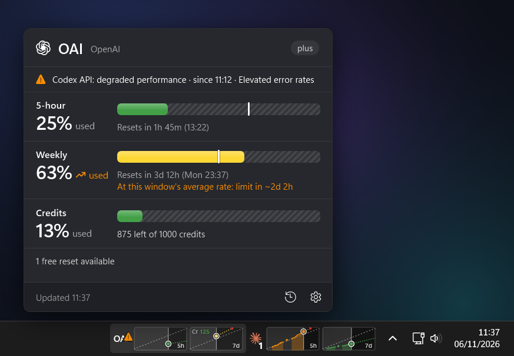
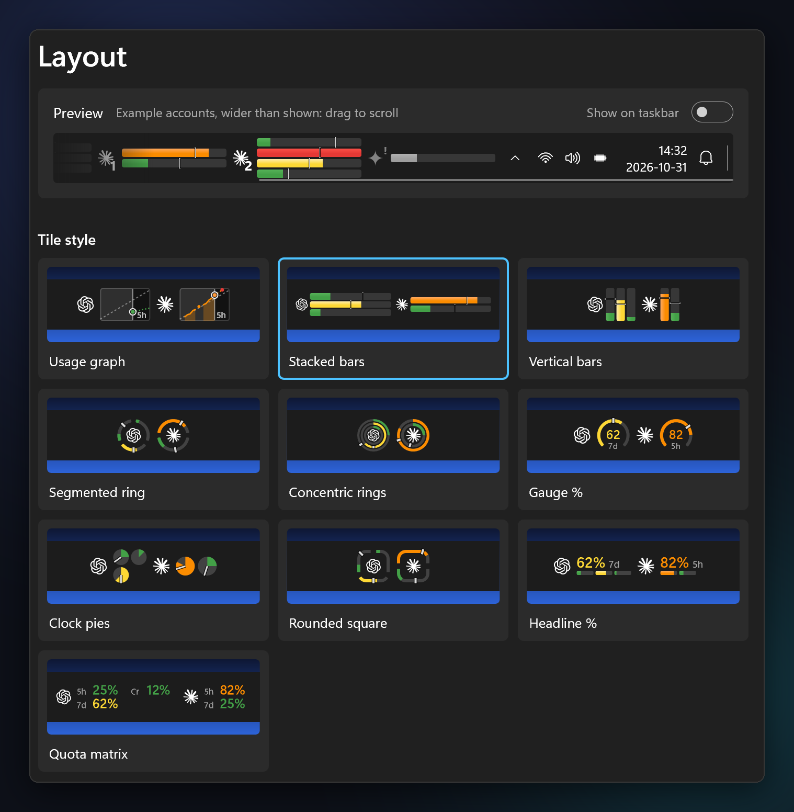

# Taskbar AI Quota

Shows Anthropic Claude, OpenAI/Codex, Google Antigravity, GitHub Copilot, and OpenCode Go AI agent and LLM subscription quota usage as compact bars on the Windows 11 taskbar.
Can show on the primary taskbar only, all taskbars, or one specific monitor.

## What It Shows

Each visible account gets one compact taskbar column with the quotas you choose:

- **Anthropic Claude:** 5-hour, weekly, Fable weekly, and monthly extra usage
- **OpenAI/Codex:** 5-hour, weekly, and prepaid credits against a max you set
- **Google Antigravity:** short-window and weekly Gemini pools and Gemini Argon weekly; Claude/GPT pool limits and its other reported quotas in the details flyout
- **GitHub Copilot:** the monthly AI credits allowance (Copilot Free's included); additional usage and an organization's pooled credits in the details flyout
- **OpenCode Go:** 5-hour, weekly, and monthly usage limits

Ten tile styles, from stacked or vertical bars to rings, gauges, a usage graph and a quota matrix, show each account's logo or label beside its meters, with threshold colors (default, colorblind or your own) and optional pace markers. Hover a column for its details flyout: percentages, reset times, pace, when usage is projected to reach the limit, plan details, errors, and the limits without a taskbar bar. Click a column to refresh it; right-click it for settings, usage history and hiding accounts.

While a provider's public status page reports a problem, its accounts show a warning triangle, and optional Windows notifications warn when a quota reaches the threshold you choose. Taskbars at the left or right of the screen (Windows 11's own taskbar position setting) get a layout that stacks down them.

Details: [taskbar, flyout and notifications](docs/taskbar.md).

## Setup

Install **Taskbar AI Quota** from the Windhawk catalog. Click the **AI +** taskbar tile to open the settings window, choose **Add account** and a provider, then type a label (or keep the default) and press Enter: its sign-in window opens.

- **Anthropic** and **OpenAI**: approve in a browser on this PC; the mod catches the redirect on `localhost` (Anthropic also offers a code to paste).
- **GitHub Copilot**: enter the code the window shows at `github.com/login/device`.
- **OpenCode Go**: paste an API key from the OpenCode console.
- **Google Antigravity**: no sign-in; keep the signed-in Antigravity app or CLI running.

The mod refreshes its sign-ins itself, so the bars keep working without re-running any CLI. Sign-in details, signing out and removing accounts: [accounts and sign-in](docs/accounts.md).

## Settings

Right-click any quota column and choose **Settings**. The window follows the Windows theme, and changes save as you make them.

- **Accounts:** add, reorder, show or hide, rename, choose taskbar quotas and identity, record history, sign in or out, remove
- **Layout**, with a live taskbar preview: tile style, position on the taskbar, sizes, logo and number badge, identity position, bar text, pace markers, spacing
- **Display:** material, used or remaining, usage colors and thresholds, stale marker, provider outages, additional OpenAI rate limits
- **Behavior:** language, displays, hover details, polling, hidden accounts, threshold notifications
- **History:** recording, retention, the usage history window's default time span, storage folder
- **About:** version info for bug reports, links, contributors, credits, license

Every setting: [settings reference](docs/settings.md).

## Languages

The taskbar, the details flyout, notifications, and the settings, usage history and sign-in windows are available in English, Deutsch, Español, Français, 日本語, Português (Brasil), Русский and 简体中文. **Automatic** (the default) uses the first of your Windows display languages the mod supports, else English. To choose another, use **Settings > Behavior > Interface language**: the choice applies to your Windows user only and switches the taskbar and the open windows at once, except that an open sign-in window keeps its language and the usage history window waits for its open dialog or export to finish.

- Translations other than English are machine-made. Corrections are welcome: [open an issue](https://github.com/Cleroth/windhawk-taskbar-ai-quota/issues/new) or a pull request (each language is one file, `src/i18n/lang-<tag>.h`).
- Numbers follow your Windows regional format whatever the language: its decimal separator (`12,5`) and, for counts and the settings' number boxes, its digit grouping (`1.234.567`, `12,34,567`); a change shows at the next update. `%`, `$`, `USD` and the `k`/`M` suffixes stay, and amounts are never grouped. Taskbar and flyout times use the regional time format; the usage history window uses its language's compact 24-hour form.
- Buttons in Windows' own dialogs (confirmations, the save dialog, the color picker) follow your Windows display language.
- These stay in English: brand, provider and model names; text the providers supply (plan and quota names, status page incidents, sign-in error details); the Windhawk log; and CSV exports.

## Usage history

Recording is on by default, per Windows user and per account, reusing the normal polls. Open **Usage history** from a column's right-click menu or **Settings > History** to compare quota timelines across accounts, overlay the previous week, see extra usage and credits, and export CSV; the details flyout's charts and the usage graph tiles use the same recordings. Samples stay on this PC, unencrypted, in the mod's Windhawk storage (a folder per Windows user, which other users of the PC can read), kept forever by default, with Antigravity readings older than 15 days kept about 10 minutes apart. Windhawk deletes the mod's storage when it removes the mod, as far as it can; to be sure, use **Clear all history...** first. Earlier versions' history moves there from `%LOCALAPPDATA%\TaskbarAIQuota\` on the first start.

Viewer, recording rules, storage, retention and export: [usage history guide](docs/usage-history.md). Manual verification: [usage history checks](docs/usage-history-verification.md).

## Security

The mod runs its own sign-ins and stores tokens and keys encrypted with Windows DPAPI (current user) in its own Windhawk storage. It never reads or writes other apps' credentials (Claude Code, Codex, OpenCode, GitHub CLI, Visual Studio, Windows Credential Manager), never follows HTTP redirects, and sends refresh tokens only to provider token endpoints. Details: [accounts and sign-in > Security](docs/accounts.md#security).

## Limitations

- Windows 11 taskbar only.
- x86-64 only.
- Left and right taskbars need Windows 11's own taskbar position setting with a tray that stacks its icons down the taskbar (26200.9457, KB5129195, or later). On the first builds with the setting no bars show on a side taskbar, with a note in Settings; they return when the taskbar moves back to the top or bottom. A taskbar another mod turns sideways (such as Vertical Taskbar without its native mode) keeps the layout across, turned with the taskbar.
- Many accounts, or many usage graph charts each, can fill a side taskbar's length; the bars don't scroll.
- Left side and Right of Start are experimental. They share the taskbar's spacing only with mods that add to it the same way (such as Taskbar System Info); Start Button Position and Taskbar Styler rules on the app list's margin conflict with them. A conflicting mod the bars don't detect can leave the taskbar's spacing wrong after the bars move or the mod is disabled, until that mod rewrites it or Explorer restarts.
- Specific displays use detected taskbar order: `Display 1` is primary and later entries are secondary taskbars.
- Anthropic/OpenAI/GitHub Copilot require one browser sign-in per configured account, and OpenCode Go one pasted API key.
- Antigravity requires a signed-in app or CLI session to remain running; older IDE builds may also require an open workspace.
- Antigravity servers without pooled-quota support show only their current limiting quota; weekly stays unavailable and pace ticks are disabled.
- OpenAI sign-in needs `localhost:1455` (or `1457`) free for the browser redirect.
- Anthropic and OpenAI sessions refresh automatically, and GitHub Copilot sessions do when GitHub issues expiring tokens; sign in again if a stored session is missing, invalid, or revoked. The mod never refreshes an OpenCode Go key: after deleting or replacing it in the console, sign in again with the new one.
- Model, surface and additional limits, plan names and free resets come from undocumented fields. Anthropic's free resets need the mod's Claude Code version to stay recent; they can disappear until a mod update.
- OpenAI's Codex status comes from the page feed of OpenAI's status page (`status.openai.com/proxy/...`), which isn't a documented API: its standard summary leaves Codex out. Should a provider change its page, its marks stop showing until a mod update; the Windhawk log names the problem.
- GitHub Copilot uses an undocumented endpoint (`copilot_internal/user`, as VS Code does) that GitHub can change. Its 5-hour and weekly rate limits are reported only to editors during chats, so they aren't shown; neither are code completions.

## Building from source

Windhawk and its catalog take a single file, so the source lives in `src/` as fragments of one translation unit, included in order by `src/taskbar-ai-quota.cpp`. `pwsh generate-mod.ps1` combines them into the committed `local@taskbar-ai-quota.wh.cpp`; edit `src/` rather than that generated file, regenerate, then run `pwsh install-windhawk.ps1` as Administrator to install it locally. Edits made in Windhawk's mod editor need to be ported back into `src/`.

## Suggestions & Bugs

Have a suggestion or found a bug? [Open an issue](https://github.com/Cleroth/windhawk-taskbar-ai-quota/issues/new).

## Contributors

Thanks to everyone who contributed:

- [amirf147](https://github.com/amirf147): Antigravity's Gemini Argon weekly quota
- [Hugh Macdonald](https://github.com/HughMacdonald): provider outage marks from the status pages
- [incconutwo](https://github.com/incconutwo): Google Antigravity support, StackPanel taskbar trays on newer Windows 11 builds, and left and right taskbars
- [smnio](https://github.com/smnio): sign-in hardening (no HTTP redirects, refusing another sign-in's pasted Anthropic code)
- [Sof2245](https://github.com/Sof2245): GitHub Copilot support, polling only from the taskbar's Explorer process, model and extra limits, free resets and the Claude plan in the details flyout, notification levels, the Custom usage palette, Copy version info, and Antigravity's other quota buckets
- [yalov](https://github.com/yalov): the first GitHub Copilot implementation ([#12](https://github.com/Cleroth/windhawk-taskbar-ai-quota/pull/12))

## License

[MIT](LICENSE)
